# OCR Scan Restoration

## Overview

Damaged scans need tiered treatment: not every document needs full reconstruction, and full reconstruction on every page wastes time. This skill applies progressively deeper fixes guided by a **quality score** measured after each tier. Stop the moment quality is sufficient.

**Core principle:** Measure first, fix proportionally, measure again.

---

## When to Use

```dot
digraph ocr_decision {
    rankdir=LR;
    "Got OCR text?" [shape=diamond];
    "Score quality" [shape=box];
    "Score >= 0.9?" [shape=diamond];
    "Score >= 0.7?" [shape=diamond];
    "Score >= 0.45?" [shape=diamond];
    "Tier 0: Accept" [shape=box, style=filled, fillcolor=lightgreen];
    "Tier 1: Auto cleanup" [shape=box];
    "Tier 2: Deep repair" [shape=box];
    "Tier 3: LLM rewrite" [shape=box];
    "Tier 4: Block rewrite" [shape=box];
    "Re-score after each tier" [shape=diamond];

    "Got OCR text?" -> "Score quality";
    "Score quality" -> "Score >= 0.9?" ;
    "Score >= 0.9?" -> "Tier 0: Accept" [label="yes"];
    "Score >= 0.9?" -> "Score >= 0.7?" [label="no"];
    "Score >= 0.7?" -> "Tier 1: Auto cleanup" [label="no"];
    "Score >= 0.7?" -> "Tier 0: Accept" [label="yes (good enough)"];
    "Tier 1: Auto cleanup" -> "Re-score after each tier";
    "Re-score after each tier" -> "Score >= 0.45?" [label="still bad"];
    "Re-score after each tier" -> "Tier 0: Accept" [label="good enough"];
    "Score >= 0.45?" -> "Tier 2: Deep repair" [label="no"];
    "Score >= 0.45?" -> "Tier 1: Auto cleanup" [label="yes"];
    "Tier 2: Deep repair" -> "Tier 3: LLM rewrite" [label="still bad"];
    "Tier 3: LLM rewrite" -> "Tier 4: Block rewrite" [label="still bad"];
}
```



**Use this skill when:**
- OCR output has >5% unrecognizable words
- Words are systematically merged (`этопроблема`) or split (`э то п р о б л е м а`)
- Special characters appear mid-word (`Сист!ема`, `приб*ор`)
- Whole paragraphs are unreadable after standard OCR
- Working with old documents (pre-reform spelling, historical scripts)
- Input is a low-DPI or physically damaged scan

**Don't use when:**
- OCR quality score > 0.9 (clean scan, nothing to fix)
- Only 1–3 isolated typos (just fix them directly)

---

## Step 0: Measure Quality Score

Before any repair, calculate a **garble score** for each block:

```python
import re

# 1–2-letter words that are NORMAL Russian, not evidence of a split.
# Without this list every preposition in clean prose is scored as damage,
# and clean paragraphs drop under 0.9 — i.e. get routed into repair.
RU_SHORT_OK = {
    'в','с','к','о','у','и','а','я','б','ж','э',
    'ли','же','бы','не','ни','но','по','до','за','из','на','от','об','во','со','ко',
    'то','та','те','ту','их','им','ее','её','ей','ею','он','мы','вы','ты','да','уж','ль',
}

def ocr_quality_score(text: str, is_word=None) -> float:
    """Returns 0.0 (unreadable) to 1.0 (perfect).
    is_word: optional dictionary lookup (see 'Golden rule' below)."""
    if not text.strip():
        return 0.0

    total = len(text)

    # Garbage signal: non-alphabetic chars inside words.
    # '%' and '$' next to a digit are ordinary text ("10%", "$5"), not damage.
    garbage_chars = len(re.findall(r'(?<!\d)[%$](?!\d)|[!*|#@^&\\<>~`]', text))

    # Digits inside alphabetic words (OCR mistaking letters for digits).
    # Lowercase only — uppercase neighbours mean a formula: К3ПО4, H2O, А4.
    digit_in_word = len(re.findall(r'[a-zа-яё]\d[a-zа-яё]', text))

    words = text.split()

    # Long tokens: Russian genuinely has 20+ letter words
    # ("переосвидетельствование", "высокопревосходительство"), so length alone
    # is not damage. Penalise only tokens the dictionary does not recognise.
    def long_bad(w: str) -> bool:
        w = w.strip('.,;:!?»«()')
        if len(w) <= 22:
            return False
        return not (is_word and is_word(w))
    long_tokens = sum(1 for w in words if long_bad(w))

    # Letter-spaced fragments: single letters separated by spaces ("э т о")
    spaced_letters = len(re.findall(r'(?<!\w)[A-Za-zА-Яа-яёЁ] [A-Za-zА-Яа-яёЁ] [A-Za-zА-Яа-яёЁ](?!\w)', text))

    # Short incoherent fragments (2-3 non-word chars sequences)
    garbage_clusters = len(re.findall(r'[^\w\s,.;:!?«»\-–—()]{2,}', text))

    # Micro-token splits: 1-2 char alphabetic tokens surrounded by longer tokens
    # Catches split words like "тв ёрдых", "пе р еда ётся", "у дельный" —
    # but NOT ordinary prepositions, which is what RU_SHORT_OK filters out.
    micro_splits = sum(
        1 for i, w in enumerate(words)
        if len(w) <= 2 and w.isalpha() and w.lower() not in RU_SHORT_OK
        and (i > 0 and words[i-1].isalpha() or i < len(words)-1 and words[i+1].isalpha())
    )

    # Garbage density: even 5-10 garbage chars in 200-char block is severe
    # Normalize by block length AND by absolute count to catch dense damage
    garbage_density = garbage_chars / max(len(words), 1)  # per-word ratio

    penalty = (
        garbage_chars * 3 +
        digit_in_word * 4 +
        long_tokens * 5 +
        spaced_letters * 2 +
        garbage_clusters * 6 +
        micro_splits * 3 +
        garbage_density * 15  # density penalty independent of block length
    )

    score = max(0.0, 1.0 - penalty / max(total, 1))
    return round(score, 3)
```

**Thresholds:**

| Score | Tier | Action |
|-------|------|--------|
| ≥ 0.90 | 0 | Accept as-is |
| 0.70–0.89 | 1 | Basic auto-cleanup |
| 0.45–0.69 | 2 | Deep pattern repair |
| 0.20–0.44 | 3 | LLM block reconstruction |
| < 0.20 | 4 | Full manual block rewrite |

**Always score per block** (paragraph or page), not the whole document — some blocks may be Tier 0 while others need Tier 4.

**A low score is a suspicion, not a licence.** Some perfectly clean content reads as
damaged to any formula — an answer key (`Ответы: а б в г д`) and a variable row
(`Даны величины x y z t`) are indistinguishable from letter-spacing by shape alone.
That is tolerable only because the repair functions re-check before acting: each one
verifies its own precondition and declines. Never write a rule that trusts the score
instead of testing its own input.

**When formula score and visual assessment diverge — trust your eyes.** The formula catches specific patterns (garbage chars, long tokens, micro-splits) but can miss:
- Semantically wrong words that look clean (`веоь` instead of `вес` — no garbage chars, but wrong)
- Merged words just under the 18-char threshold
- Systematic character substitutions (`!` for `и`, `0` for `О`)

When you suspect damage that the formula doesn't detect, inspect the block manually and escalate the tier.

---

## Golden Rule: Only Fire on Provably Broken Input

Restoration is **asymmetric**. A missed typo stays visible — someone will catch it.
A "corrected" word looks like ordinary text and is invisible forever. So a wrong fix
costs far more than a skipped one, and every rule below is built to fail silent
rather than fail loud.

**An automatic fix may fire only when it turns a non-word into a word.**
Everything else is a *proposal* for a human, never an edit.

That single rule is what separates a repair from a corruption. `вдоме` is not a
word and `доме` is → splitting is safe. `вопрос` *is* a word → hands off, even
though it starts with the preposition `в`. Without that test, the same regex
mangles every word in the document that happens to begin with a preposition.

```python
# Dictionary gate. pymorphy3 is the cheapest option for Russian; hunspell or a
# frequency wordlist work equally well. Any callable str -> bool will do.
try:
    import pymorphy3
    _morph = pymorphy3.MorphAnalyzer()
    def is_word(w: str) -> bool:
        return _morph.word_is_known(w.lower())
except ImportError:
    is_word = None   # no dictionary -> proposal-only mode, see below
```

**No dictionary available?** Then the word-level rules (1.3, 2.1) produce
proposals only and change nothing. That is the correct degradation: a rule that
cannot tell a word from a fragment has no business editing text unattended.

Three consequences that hold throughout:

| | |
|---|---|
| **Never delete** | Filters move content to a `dropped` list that the dump prints. Deletion is the one edit no later tier can undo. |
| **Never touch a token that is already a word** | Applies even when it looks suspicious. Ambiguity resolves in favour of the original. |
| **Ambiguous stays ambiguous** | When both readings are real words (`за дачей` / `задачей`), no rule can decide. That is Tier 3's job — it has the context. |

---

## Tier 1: Automated Cleanup

Apply in order. Re-score after each function group. Stop if score ≥ 0.9.

Tier 1 is **not** applied to blocks that already score ≥ 0.9 — score first, repair
second. See the Integration Template; running cleanup before scoring is how clean
pages get damaged.

### 1.1 Invisible and control characters

```python
import unicodedata

def clean_control_chars(text: str) -> str:
    # Remove soft hyphens (U+00AD) — common OCR line-break artifact
    text = re.sub(r'([A-Za-zА-Яа-яёЁ])\u00AD\s*([A-Za-zА-Яа-яёЁ])', r'\1\2', text)
    # Normalize non-breaking spaces, zero-width chars
    text = text.replace('\u00a0', ' ').replace('\u200b', '').replace('\ufeff', '')
    # Collapse multiple spaces
    text = re.sub(r'  +', ' ', text)
    return text
```

### 1.2 Letter-spacing collapse
When OCR spaces out individual letters: `"э т о п р и м е р"` → `"это пример"`

A bare "4 single letters in a row" pattern also eats things that are *supposed* to
be single letters — answer keys, variable lists, table rows:

```
Ответы: а б в г д        →  Ответы: абвгд        ← destroyed
Даны величины x y z t    →  Даны величины xyzt   ← destroyed
```

Three gates fix that. Real letter-spacing is **systemic** (a whole block is
spaced, not four tokens), it produces **pronounceable** strings, and it never
switches script mid-word:

```python
VOWELS = set('аеёиоуыэюя') | set('aeiouy')

def _is_enumeration(letters: str) -> bool:
    """а б в г д — an alphabetical run is a list marker, not damage."""
    return len(letters) >= 3 and all(letters[i] < letters[i+1] for i in range(len(letters)-1))

def collapse_letter_spacing(text: str, min_run: int = 4, density: float = 0.30) -> str:
    tokens = text.split()
    if not tokens:
        return text
    singles = sum(1 for t in tokens if len(t) == 1 and t.isalpha())
    if singles / len(tokens) < density:
        return text                       # spacing is not systemic here — leave it
    def join_run(m):
        joined = m.group(0).replace(' ', '')
        low = joined.lower()
        if not (set(low) & VOWELS):
            return m.group(0)             # "x y z t" — not a word
        if _is_enumeration(low):
            return m.group(0)             # "а б в г д" — an answer key
        if re.search(r'[А-Яа-яЁё]', joined) and re.search(r'[A-Za-z]', joined):
            return m.group(0)             # "x y z t и n" — a variable row
        return joined
    pattern = rf'(?<!\w)([A-Za-zА-Яа-яёЁ] ){{{min_run-1},}}[A-Za-zА-Яа-яёЁ](?!\w)'
    return re.sub(pattern, join_run, text)
```

The join still yields glued words (`э т о п р и м е р` → `этопример`); that is
expected. Word boundaries inside the run are Tier 3's problem, not a regex's.

### 1.3 Merged prepositions — PROPOSAL ONLY, never automatic

> **Not part of the automatic tier.** A "preposition + 4 or more letters" regex
> fires on a large share of ordinary Russian vocabulary, because thousands of real
> words simply begin with those letters. Measured on clean text, it damaged **6 of
> 6** test sentences:
>
> | было | станет |
> |---|---|
> | `Внимание! Вопрос о населении` | `В нимание! В о прос о на селении` |
> | `Изучение доклада заняло` | `Из учение до клада за няло` |
> | `обсуждали на конференции` | `об суждали на к о нференции` |
>
> Note `вопрос` → `в о прос`: the loop re-splits its own output, so damage compounds.

The condition can be narrowed, but only by a dictionary — the string `в` + 4 letters
carries no information about whether a split belongs there. The test that works:
**the whole token must not be a word, and the remainder must be one.**

```python
PREPOSITIONS = ['в', 'на', 'из', 'по', 'к', 'от', 'до', 'за', 'для', 'под', 'над',
                'без', 'при', 'про', 'об', 'со', 'во', 'о', 'а', 'и', 'но', 'или']

def propose_merged_prepositions(text: str, is_word=is_word):
    """[(token, 'prep rest'), ...] — proposals for review. Applies nothing."""
    if is_word is None:
        return []                                  # no dictionary -> stay silent
    out = {}
    for tok in re.findall(r'[А-Яа-яЁё]+', text):
        low = tok.lower()
        if len(low) < 5 or is_word(low):
            continue                               # 'вопрос' is a word -> skip
        for prep in PREPOSITIONS:
            rest = low[len(prep):]
            if low.startswith(prep) and len(rest) >= 4 and is_word(rest):
                out[tok] = f'{tok[:len(prep)]} {tok[len(prep):]}'
                break
    return sorted(out.items())
```

Even gated this way it stays a proposal: `вдоме` is unambiguous, but `водном`
(`в одном` / `водном`) is not, and only a human or Tier 3 can tell which. Print
proposals into the dump and apply the ones you have read.

### 1.4 Known OCR substitutions

> **A dict of `str.replace` pairs cannot be used here.** `replace` has no notion of
> context, so each entry fires everywhere the substring occurs. The version this
> skill used to carry destroyed clean text on contact:
>
> | было | станет | почему |
> |---|---|---|
> | `Объект съёмки подъехал` | `Обект сёмки подехал` | `'ъ': ''` deletes every hard sign, not just terminal ones |
> | `в 1920 году`, `на 10%` | `в 192о году`, `на 1о%` | `'0': 'о'` eats the digit zero everywhere |
> | `Файл class1.html` | `Файл cлass1.htmл` | `'l': 'л'` eats Latin text |
>
> Two entries were also dead: `'рн': 'рн'` is a no-op, and `'ЗЗ': 'Зз'` fires on
> legitimate abbreviations. Both are dropped.

Every substitution needs a context guard, and the risky ones additionally need the
dictionary test — apply only if a real word comes out:

```python
# Latin glyphs that are visually identical to Cyrillic ones
HOMOGLYPHS = {'a':'а','e':'е','o':'о','p':'р','c':'с','y':'у','x':'х',
              'A':'А','B':'В','E':'Е','K':'К','M':'М','H':'Н','O':'О',
              'P':'Р','C':'С','T':'Т','X':'Х'}
# damaged char -> candidate repairs, tried in order
CANDIDATES = {'0': ['о', ''], '3': ['з', ''], '6': ['б', 'ъ', ''],
              '1': ['і', 'и', ''], '!': ['и', '', 'ь'], '|': ['и', 'л', '']}

def _repair_token(tok: str, is_word) -> str:
    """A damaged char must sit BETWEEN two Cyrillic letters — that spares
    'рис.1', '1920', 'К3ПО4' and a sentence-final '!'."""
    cyr = re.compile(r'[А-Яа-яЁё]')
    positions = [i for i, c in enumerate(tok)
                 if c in CANDIDATES and 0 < i < len(tok) - 1
                 and cyr.match(tok[i-1]) and cyr.match(tok[i+1])]
    if not positions or is_word is None:
        return tok
    if is_word(tok.strip('.,;:!?»«()')):
        return tok                                   # already a word: hands off
    for i in positions:
        for cand in CANDIDATES[tok[i]]:
            trial = tok[:i] + cand + tok[i+1:]
            if is_word(trial.strip('.,;:!?»«()')):
                return trial                         # a real word came out: accept
    return tok                                       # nothing won: leave for Tier 3

def apply_ocr_fixes(text: str, pre1918: bool = False, is_word=is_word) -> str:
    # A Latin glyph between two Cyrillic letters is always OCR damage —
    # no Russian word mixes scripts mid-token. Safe without a dictionary.
    for lat, cyr in HOMOGLYPHS.items():
        text = re.sub(rf'(?<=[А-Яа-яЁё]){lat}(?=[А-Яа-яЁё])', cyr, text)
    # Digits / stray punctuation inside a word: only if a real word comes out.
    def fix_tok(m):
        tok = m.group(0)
        if not re.search(r'[А-Яа-яЁё]', tok):
            return tok                               # 1920, 10%, class1.html
        return _repair_token(tok, is_word)
    text = re.sub(r'\S+', fix_tok, text)
    if pre1918:                                      # opt-in, never the default
        for bad, good in (('ѣ','е'), ('і','и'), ('ѳ','ф'), ('ѵ','и')):
            text = text.replace(bad, good)
        text = re.sub(r'ъ\b', '', text)              # TERMINAL hard sign only
    return text
```

The candidate loop is why this beats a fixed mapping: `Сист!ема` needs the `!`
*deleted* while `с!ла` needs it replaced with `и`, and only the dictionary knows
which. Pre-1918 conversion is behind a flag — running it on a modern document is
pure damage, and on a historical one it destroys the orthography you may be trying
to preserve.

---

## Tier 2: Deep Pattern Repair

Use when Tier 1 leaves score between 0.45–0.69. Apply morphological and context-window analysis.

**Important limitation:** `split_word_candidates` catches two-fragment splits but not arbitrary mid-syllable breaks (e.g., `пе р еда ётся`, `тв ёрдых`). If you see random intra-syllable fragmentation throughout a block, skip Tier 2 and escalate directly to Tier 3 (LLM reconstruction) — no local rule will help.

### 2.1 Word-split detector

> **The suffix-halves test was broken.** It cut each suffix at position 2 and
> matched the halves independently, so `'ние'` became "any word ending in `ни`
> followed by any word starting with `е`" — which is a description of ordinary
> Russian, not of damage:
>
> | было | станет |
> |---|---|
> | `Они его видели` | `Ониего видели` |
> | `Мы должны идти его встречать` | `Мы должны идтиего встречать` |
>
> It also joined with `' '.join(text.split())`, silently flattening every newline
> in the block.

The reliable test needs no suffix list at all: **the join is a word and neither
fragment is.** That is what distinguishes `образова` + `ние` from `они` + `его`.

```python
def split_word_candidates(text: str, is_word=is_word):
    """(auto, review). auto: neither fragment is a word and the join is one."""
    if is_word is None:
        return [], []
    words = text.split()
    auto, review = [], []
    for i in range(len(words) - 1):
        a, b = words[i], words[i+1].strip('.,;:!?»«()')
        if not (a.isalpha() and b.isalpha()):
            continue
        comb = a + b
        if not is_word(comb):
            continue
        aw, bw = is_word(a), is_word(b)
        if not aw and not bw:
            auto.append((i, f'{a} {b}', comb))       # 'образова ние' -> 'образование'
        elif not (aw and bw):
            review.append((i, f'{a} {b}', comb))     # 'тв ёрдых' — propose, don't apply
    return auto, review

def apply_split_words(text: str, is_word=is_word) -> str:
    auto, _ = split_word_candidates(text, is_word)
    if not auto:
        return text
    words = text.split()
    drop = {i + 1 for i, _, _ in auto}
    merge = {i: c for i, _, c in auto}
    return ' '.join(merge.get(i, w) for i, w in enumerate(words) if i not in drop)
```

**In practice `auto` fires rarely, and that is correct.** Most real splits leave at
least one fragment that is itself a valid word (`тв ёрдых`, `расширяет ся`,
`у дельный`), so they land in `review`. When both halves are valid words the pair is
genuinely ambiguous — `за дачей` and `задачей` are both real Russian — and no
local rule can resolve it. Send those to Tier 3, which has the context to decide.

Print `review` into the dump; do not apply it unread.

### 2.2 Glued-token splitter

> **Tokens over 18 chars are not "almost always merged words".** Russian has plenty
> of them, and splitting at the first `в`/`на`/`по` inside the token cuts straight
> through real vocabulary:
>
> | было | станет |
> |---|---|
> | `Высокопроизводительность` | `Высокопроиз водительность` |
> | `Переосвидетельствование` | `Переос видетельствование` |
> | `высокопревосходительство, электрооборудование` | `высокопре восходительство, электрооборудо вание` |
>
> A letter that occurs inside most long words carries no boundary information.

Split only where a boundary **cannot** occur inside a single word — a case
transition or a missing space after a sentence period. Length stays as a gate, not
as evidence, and the token-wise walk preserves newlines:

```python
def split_glued_tokens(text: str, min_len: int = 18) -> str:
    def fix(tok: str) -> str:
        if len(tok) < min_len:
            return tok                    # long real words stay untouched
        # "текстдома Началось" — lower→Upper with 3+ chars on each side.
        # The length gate spares YouTube, iPhone, МиГ-29.
        tok = re.sub(r'(?<=[а-яёa-z]{3})(?=[А-ЯЁA-Z][а-яёa-z]{2})', ' ', tok)
        # "конец.Начало" — missing space after a period
        tok = re.sub(r'(?<=[а-яё]\.)(?=[А-ЯЁ][а-яё]{2})', ' ', tok)
        return tok
    return ''.join(p if p.isspace() else fix(p) for p in re.split(r'(\s+)', text))
```

Lowercase glue (`этопримертекста`) has no such marker and is deliberately left
alone — Tier 3 reconstructs it from context. Do not add a letter/digit rule here
either: it would split `А4`, `Т-34` and `рис.5`.

### 2.3 Garbage fragment filter

> **"Non-alphabetic" is not "garbage".** Digits, operators and punctuation are what
> tables, formulas, dates and references are *made of*, so the alpha-ratio test
> deleted the most information-dense lines on the page — silently and
> irreversibly. On a five-line table it destroyed four:
>
> | было | станет |
> |---|---|
> | `Таблица 3. Динамика показателей`<br>`1920   1925   1930   1935   1940`<br>`E = m * c²`<br>`§ 15. — 3, 5, 7—9`<br>`12.05.1934 — 15.06.1934` | `Таблица 3. Динамика показателей` |

Two changes make it safe: judge against a **garbage character class** rather than
"not a letter", and **never delete** — hand the dropped lines back so the dump can
show them.

```python
GARBAGE_CLASS = r'[!*|#@$%^&\\<>~`_=+\[\]{}/]'

def separate_garbage_lines(text: str):
    """Returns (kept_text, dropped_lines). Nothing is discarded silently."""
    kept, dropped = [], []
    for line in text.split('\n'):
        s = line.strip()
        # A digit or any 3+ letter word means content. Never drop those.
        if len(s) <= 5 or re.search(r'\d', s) or re.search(r'[А-Яа-яЁёA-Za-z]{3,}', s):
            kept.append(line)
            continue
        if len(re.findall(GARBAGE_CLASS, s)) / len(s) >= 0.5:
            dropped.append(line)
        else:
            kept.append(line)
    return '\n'.join(kept), dropped
```

Always write `dropped` into the dump. A filter you cannot audit is a filter you
cannot trust, and this is the only step whose mistakes no later tier can repair.

---

## Tier 3: LLM Block Reconstruction

When automated repair fails (score < 0.45), send each corrupt block to an LLM with full context.

### Structure the prompt correctly

```python
def reconstruct_block_with_llm(
    corrupt_text: str,
    document_context: str,
    preceding_clean: str,
    language: str = "Russian"
) -> str:
    prompt = f"""You are restoring a damaged OCR scan of a document.

DOCUMENT CONTEXT (what this document is about):
{document_context}

PRECEDING CLEAN TEXT (for continuity):
{preceding_clean}

CORRUPT OCR BLOCK TO RESTORE:
{corrupt_text}

Instructions:
1. Read the corrupt block carefully. Most words are recognizable fragments.
2. Use document context and preceding text to understand the topic.
3. Reconstruct the full coherent text in {language}.
4. Preserve all technical terms, numbers, references (figure numbers, etc.).
5. Do NOT add information not implied by the corrupt text.
6. Return ONLY the restored text, no explanations.

RESTORED TEXT:"""
    return call_llm(prompt)
```

### Key parameters for reconstruction

- **Temperature: 0.1** — low creativity, high fidelity
- **Include document_context** — even 2–3 sentences about the topic dramatically improves reconstruction
- **Include 2–3 preceding clean paragraphs** — continuity prevents hallucination
- **Process block by block**, not the whole document — shorter context = better focus

---

## Tier 4: Full Manual Block Rewrite

When Tier 3 still produces unreliable output (score < 0.20, or LLM hallucinating).

### The dump-debug-rewrite loop

```python
# 1. Dump all blocks to a text file for human review
def dump_blocks(blocks: list[dict], output_path: str) -> None:
    with open(output_path, 'w', encoding='utf-8') as f:
        for i, block in enumerate(blocks):
            f.write(f'=== BLOCK {i} ({block.get("type", "body")}) '
                    f'score={block.get("score", "?")} ===\n')
            f.write(block.get('text', '') + '\n')
            # What the pipeline declined to do on its own — the whole point of
            # proposal mode is that a human actually reads this.
            for p in block.get('proposals', []):
                f.write(f'  ? PROPOSAL: {p}\n')
            for d in block.get('dropped', []):
                f.write(f'  - DROPPED : {d!r}\n')
            f.write('\n')

# 2. Identify corrupt blocks (those with score < threshold)
corrupt_indices = [
    i for i, b in enumerate(blocks)
    if ocr_quality_score(b.get('text', '')) < 0.45
]

# 3. Store manual corrections by block index
MANUAL_CORRECTIONS = {
    # Written after reading the dump and domain knowledge
    5: "При нагревании большинство твёрдых и жидких тел расширяется...",
    7: "Тепло передаётся лучеиспусканием и прикосновением...",
    # etc.
}

# 4. Apply corrections
def apply_manual_corrections(blocks: list[dict], corrections: dict) -> list[dict]:
    for i, block in enumerate(blocks):
        if i in corrections:
            block['text'] = corrections[i]
    return [b for b in blocks if b.get('text', '').strip()]
```

### How to write manual corrections

When reading the dump:
1. **Find where the sentence was going** — even `"гор ения"` implies `"горения"`
2. **Use domain knowledge** — what topic is this page about?
3. **Look at the preceding and following clean blocks** — reconstruct the argument flow
4. **Verify numbers and proper nouns** — these are usually recognizable even in garbage
5. **Write naturally** — don't try to preserve garbage; rewrite the whole sentence

---

## The Dump-Debug Cycle (Critical Pattern)

**Always generate a text dump before creating the final document.** This is the fastest feedback loop.

```
write fix → generate_dump() → read dump → spot errors → write more fixes → repeat
```

Never go straight from raw OCR to final document. The dump reveals:
- Which blocks still have garbage
- Whether your regex is over-applying
- Blocks that need escalation to a higher tier

**Name dumps sequentially:** `blocks_dump_v1.txt`, `v2.txt`, etc. Keep old ones for comparison.

---

## Integration Template

```python
def process_document(
    ocr_text: str,
    document_context: str = "",
    language: str = "auto"
) -> list[dict]:
    """Full tiered OCR restoration pipeline.

    Order matters: SCORE FIRST, repair second. Running cleanup over every block
    before scoring means a perfect page gets edited too — Tier 0 becomes
    unreachable and the only possible outcome of touching clean text is damage.
    """

    # 1. Split into blocks (paragraphs or pages)
    blocks = split_into_blocks(ocr_text)

    for block in blocks:
        # 2. Score BEFORE touching anything
        block['score'] = ocr_quality_score(block['text'], is_word)
        block['proposals'] = []
        block['dropped'] = []

        if block['score'] >= 0.9:
            continue                                   # Tier 0: hands off entirely

        # 3. Tier 1: automatic, non-destructive only
        block['text'] = clean_control_chars(block['text'])
        block['text'] = collapse_letter_spacing(block['text'])
        block['text'] = apply_ocr_fixes(block['text'])
        # proposal-only, never applied unread
        block['proposals'] += propose_merged_prepositions(block['text'])
        block['score'] = ocr_quality_score(block['text'], is_word)

        if block['score'] >= 0.7:
            continue                                   # Tier 1 was enough

        # 4. Tier 2: deep repair
        block['text'] = apply_split_words(block['text'])
        _auto, review = split_word_candidates(block['text'])
        block['proposals'] += review
        block['text'] = split_glued_tokens(block['text'])
        block['text'], block['dropped'] = separate_garbage_lines(block['text'])
        block['score'] = ocr_quality_score(block['text'], is_word)

        if block['score'] >= 0.45:
            continue                                   # Tier 2 was enough

        # 5. Tier 3: LLM reconstruction
        preceding = get_preceding_clean_text(blocks, block)
        block['text'] = reconstruct_block_with_llm(
            block['text'], document_context, preceding, language
        )
        block['score'] = ocr_quality_score(block['text'], is_word)

        # 6. Tier 4: flag for manual rewrite if still bad
        if block['score'] < 0.20:
            block['needs_manual'] = True

    # 7. Dump for review before finalizing — proposals and dropped lines included,
    #    otherwise nobody ever sees what the pipeline declined or removed.
    dump_blocks(blocks, 'blocks_dump.txt')

    return blocks
```

---

## Language-Specific Plugins

The core pipeline is universal. Add language modules as needed:

| Language | Extra fixes needed |
|----------|--------------------|
| Russian pre-1918 | Convert ѣ→е, ъ→∅ at end of words, і→и, ѳ→ф |
| German Fraktur | s/ß confusion, ü/ü lookalike |
| Old English | Long-s (ſ) → s, yogh, thorn |
| Arabic | Direction markers, hamza variants |
| Any | Build custom `OCR_FIXES` dict from your scanner's error patterns |

To build your scanner-specific dictionary: **scan 5–10 pages, identify the top 20 recurring errors, add them to `OCR_FIXES`**. Systematic OCR errors repeat predictably.

---

## Common Mistakes

| Mistake | Fix |
|---------|-----|
| **Repairing before scoring** | Score first, then pick a tier. Cleanup applied to every block edits the clean ones too, and on clean text every edit is damage |
| **A rule that fires on valid words** | Gate it on the dictionary: fix only what turns a non-word into a word. `вдоме` yes, `вопрос` never |
| **`str.replace` for OCR substitutions** | No context, so it fires everywhere: `'ъ':''` breaks `объект`, `'0':'о'` breaks `1920`. Always regex with neighbours asserted |
| **Deleting "garbage" lines** | Tables, formulas and dates look like garbage to an alpha-ratio test. Separate and report, never delete |
| **Treating token length as damage** | `переосвидетельствование` is one word. Split only at boundaries impossible inside a word |
| Applying Tier 3 (LLM) to every block | Score first — most blocks need only Tier 1 |
| Skipping the dump step | You won't see where your fixes broke clean text |
| Over-aggressive regex splitting | Always check that split didn't break good words |
| Generic prompt for LLM reconstruction | Add document_context — it cuts hallucination by 80% |
| Processing whole document as one block | Process block-by-block; score per block |
| Rebuilding the error dictionary each run | Persist `OCR_FIXES` — your scanner's errors are deterministic |
| Going straight to manual rewrite | Try Tier 2 and 3 first — saves hours |

---

## Quality Thresholds Reference

| Score | Typical appearance | Action |
|-------|--------------------|--------|
| 0.95–1.0 | Clean, typos only | Accept as-is |
| 0.80–0.94 | Occasional merged words | Tier 1 (5 min) |
| 0.60–0.79 | Many artifacts, still readable | Tier 1+2 (15 min) |
| 0.40–0.59 | Partially reconstructible | Tier 2+3 LLM |
| 0.20–0.39 | Mostly garbage, structure visible | Tier 3 LLM with strong context |
| 0.00–0.19 | Almost unreadable | Tier 4 manual rewrite per block |
